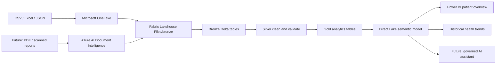

# Smart Health Intelligence Accelerator

A GitHub-ready Microsoft Fabric solution accelerator for preventive healthcare screening analytics.

The accelerator uses **synthetic data only** to demonstrate how diagnostic screening records can be loaded into Microsoft OneLake, transformed through Bronze, Silver, and Gold Delta layers, served through a Direct Lake semantic model, and explored in Power BI.

> **Safety notice:** This repository is for demonstration and analytics only. It does not diagnose disease, prescribe treatment, or replace qualified clinical interpretation.

## Architecture



## Demonstrated POC scope

- 10 synthetic patients
- 18 screenings
- 32 laboratory parameters
- 576 laboratory results
- 40 ECG, 2D Echo, X-ray, and ultrasound observations
- 576 of 576 imported result statuses validated against each row's supplied synthetic reference range
- Patient overview example: 32 parameters, 29 within range, 2 high, and 1 low
- Longitudinal HbA1c example: 5.3% -> 5.8% -> 6.2%

## Repository map

| Path | Purpose |
|---|---|
| `src/health_intelligence` | Reusable Python validation and transformation logic |
| `fabric/notebooks` | Fabric notebook source for Bronze, Silver, and Gold layers |
| `fabric/power-bi` | Semantic model, relationships, DAX, and report build guide |
| `samples/data` | Synthetic CSVs ready for Fabric ingestion |
| `schemas` | Canonical JSON schemas |
| `config` | Configurable status and safety rules |
| `docs` | Architecture, deployment, demo, and governance guides |
| `infra` | Optional Azure AI Document Intelligence Bicep template |
| `power-platform` | Future Copilot Studio assistant design |
| `tests` | Unit tests for deterministic range validation |
| `.github/workflows` | CI workflow |

## Quick start: local validation

```bash
python -m venv .venv
source .venv/bin/activate       # Windows PowerShell: .venv\Scripts\Activate.ps1
pip install -r requirements.txt
pytest -q
python -m src.health_intelligence.validate_csv samples/data/lab_results.csv
```

Expected summary:

```text
rows=576
status_matches=576
status_mismatches=0
```

## Quick start: Microsoft Fabric

1. Create a Fabric workspace and Lakehouse named `HealthcareIntelligenceLH`.
2. Create `Files/bronze` and upload the five CSV files from `samples/data`.
3. Create a Fabric notebook and attach `HealthcareIntelligenceLH` as the default Lakehouse.
4. Run notebooks in this order:
   - `01_bronze_load.py`
   - `02_silver_transform.py`
   - `03_gold_model.py`
   - `04_validate_layers.py`
5. Create a Direct Lake semantic model using:
   - `gold_patient_results`
   - `gold_screening_summary`
   - `gold_clinical_observations`
6. Follow `fabric/power-bi/BUILD_GUIDE.md`.

## What is implemented vs. planned

### Implemented in the POC

- Synthetic structured-data ingestion
- Fabric Lakehouse
- Bronze, Silver, and Gold Delta tables
- Deterministic reference-range validation
- Direct Lake semantic model
- Interactive Power BI patient overview
- Historical parameter trend

### Production extension points

- Azure AI Document Intelligence for PDF and scanned-report extraction
- Entra ID, patient-level authorization, Power BI RLS, retention, audit, and lineage
- Copilot Studio or Fabric agent experience grounded only in authorized patient data
- Clinical review workflow and human validation

## License

MIT. See `LICENSE`.
